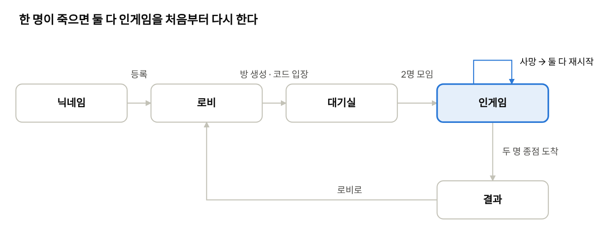
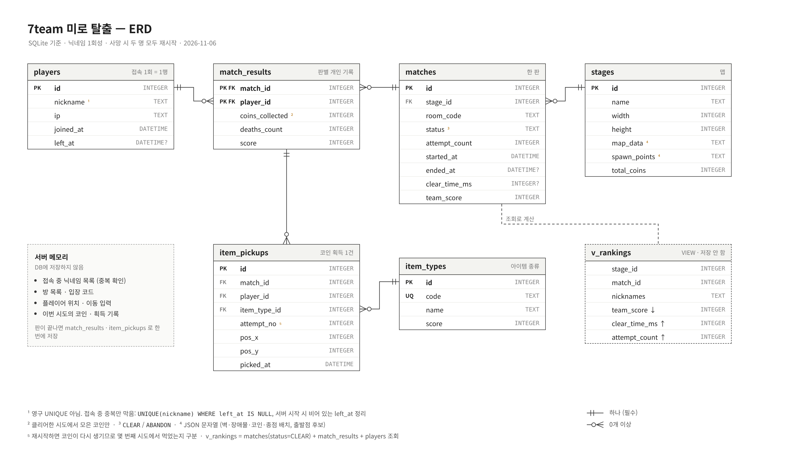

# 7team 2인 협동 미로 탈출 — 게임 기획서

최종 수정: 2026-11-06 · 7team

## 개요

두 명이 한 방에서 서로 다른 출발점에서 시작해 장애물을 피하고 코인을 모은 뒤, 두 명 모두 종점에 도착하면 클리어하는 2인 협동 미로 탈출 게임이다. 한 명이라도 죽으면 둘 다 처음부터 다시 시작한다.

| 항목 | 내용 |
| --- | --- |
| 장르 | 2인 협동 미로 탈출 |
| 인원 | 방 하나당 정확히 2명 |
| 조작 | WASD 이동 |
| 클리어 조건 | 두 명 모두 종점 도착 |
| 실패 처리 | 한 명이라도 사망하면 두 명 모두 새 랜덤 출발점에서 재시작, 코인 다시 배치 |
| 점수 | 클리어한 시도에서 모은 코인 점수 (팀 점수 = 두 명 합) |
| 랭킹 | 스테이지별, 팀(한 판) 단위 |
| 판정 | 모든 이동·충돌·획득·클리어는 서버가 판정, 클라이언트는 입력만 보냄 |

### 한 판의 흐름

1. 접속 후 닉네임을 정한다 (이번 접속에만 쓰는 1회성).
2. 한 명이 방을 만들면 입장 코드가 나오고, 다른 한 명이 그 코드로 들어온다.
3. 두 명이 모이면 서버가 스테이지를 시작하고, 각자 다른 랜덤 출발점에 배치한다.
4. 장애물을 피해 코인을 모으며 종점으로 간다. 한 명이 죽으면 3번으로 돌아간다 (시도 횟수 +1).
5. 두 명 모두 종점에 도착하면 클리어. 점수·시간·시도 횟수가 기록되고 랭킹이 갱신된다.
6. 결과 화면에서 로비로 돌아간다.

## 게임 규칙

맵은 격자(칸) 기반이고, 한 칸마다 아래 중 하나다. 판정은 서버가 이 칸 정보로 한다.

| 칸 | 표시 | 닿으면 |
| --- | --- | --- |
| 빈칸 | `.` | 지나갈 수 있음 |
| 벽 | `#` | 못 들어감 (이동 거부) |
| 장애물 | `X` | 사망 |
| 코인 | `C` | 획득 후 사라짐 |
| 종점 | `G` | 도착 (두 명 다 있으면 클리어) |
| 출발점 후보 | `S` | 게임 중에는 빈칸과 같음 |

### 이동

- WASD 입력 한 번 = 한 칸 이동 (W 위, S 아래, A 왼쪽, D 오른쪽).
- 클라이언트는 방향만 보내고, 새 위치는 서버가 계산해서 두 명에게 알린다.
- 벽이나 맵 밖으로는 이동하지 않는다. 두 명이 같은 칸에 있는 것은 허용한다.
- 서버는 한 칸 이동을 다음 순서로 판정한다: 벽 확인 → 장애물(사망) → 코인(획득) → 종점(도착).

### 코인

- 코인 칸에 들어간 사람이 먹는다. 먹은 코인은 두 명 화면 모두에서 사라진다.
- 개인 점수는 본인이 먹은 코인, 팀 점수는 두 명 합이다. 코인 하나의 점수는 아이템 종류 데이터(`item_types.score`)를 따른다.
- 두 명이 같은 순간에 같은 코인으로 들어가면, 서버가 먼저 처리한 한 명만 획득한다.

### 사망과 재시작

한 명이라도 장애물에 닿으면 서버는 다음을 한 번에 처리한다.

1. 사망한 사람의 사망 횟수 +1 (두 명이 동시에 죽으면 둘 다 +1)
2. 시도 횟수 +1 (동시에 죽어도 한 번만)
3. 이번 시도에서 모은 코인을 두 명 모두 0으로, 맵의 코인을 전부 다시 배치
4. 두 명을 출발점 후보 중 서로 다른 칸에 다시 랜덤 배치
5. 두 명에게 사망 알림과 새 출발 위치를 보냄

클리어 시간은 재시작해도 리셋하지 않고, 판이 시작된 순간부터 잔다.

### 클리어

- 먼저 종점에 도착한 사람은 그 칸에서 멈춰 기다린다 (이동 입력 무시).
- 두 번째 사람까지 도착하는 순간 클리어. 같은 순간에 사망과 도착이 겹치면 사망이 우선이다.
- 대기 중인 사람도 다른 사람이 죽으면 같이 재시작한다.

### 랭킹

클리어한 판만 스테이지별로 줄을 세운다. 닉네임이 1회성이라 개인 누적 랭킹은 없다.

1. 팀 점수 높은 순
2. 같으면 클리어 시간 짧은 순
3. 같으면 시도 횟수 적은 순

## 클라이언트 화면 흐름

화면은 6개이고, 각 화면에서 하는 일과 서버의 대답은 아래와 같다.

| 화면 | 플레이어가 하는 일 | 서버 대답 | 다음 화면 |
| --- | --- | --- | --- |
| 닉네임 | 닉네임 입력 (2\~12자) | 접속 중인 사람과 안 겹치면 등록, 겹치면 거절 | 로비 |
| 로비 | 방 만들기 또는 입장 코드 입력, 스테이지 랭킹 보기 | 방 생성 시 입장 코드 발급, 입장 시 성공 또는 실패 이유 | 대기실 |
| 대기실 | 방장은 입장 코드를 상대에게 알려줌, 나가기 가능 | 두 번째 사람이 들어오면 게임 시작 | 인게임 |
| 인게임 | WASD 이동, 코인·상대 위치·팀 점수·시도 횟수 표시 | 이동 결과, 코인 획득, 사망·재시작, 클리어 알림 | 결과 |
| 결과 | 팀 점수, 클리어 시간, 시도 횟수, 이번 판 순위 확인 | 랭킹 갱신 결과 | 로비 |
| 상대 이탈 안내 | 게임 중 상대가 나가면 표시 | 판 종료(중간 이탈로 기록) | 로비 |

인게임에서 한 명이 죽으면 결과 화면으로 가지 않고 인게임 안에서 둘 다 다시 시작하고, 게임 중 상대가 나가면 상대 이탈 안내 후 로비로 돌아간다.

닉네임은 이번 접속에만 쓴다. 접속을 끊고 다시 들어오면 새로 정한다.

### 인게임 화면에 보이는 것

- 맵 전체 (벽, 장애물, 남은 코인, 종점)
- 내 캐릭터와 상대 캐릭터 (색으로 구분)
- 팀 점수, 내 코인 수, 시도 횟수, 경과 시간
- 종점 도착 후 상대를 기다리는 중이면 "대기 중" 표시
- 사망 시 누가 죽었는지 잠깐 표시 후 재시작

## 서버 역할

서버가 모든 판정을 내린다. 클라이언트는 입력(방향)만 보내고, 위치·충돌·획득·클리어는 서버가 계산해서 두 명에게 같은 결과를 보낸다. 그래서 클라이언트를 조작해도 벽을 뚫거나 점수를 올릴 수 없다.

| 영역 | 서버가 하는 일 | 데이터 위치 |
| --- | --- | --- |
| 유저 | 닉네임 길이·문자 검사, 접속 중인 닉네임과 중복 확인, 등록 후 플레이어 ID 발급, 접속·종료 시각 기록 | 메모리 (닉네임 목록) + DB `players` |
| 방 | 입장 코드 6자리 생성 (활성 방과 안 겹치게), 입장 허용·거절, 2명이 되면 게임 시작, 빈 방 삭제 | 메모리 |
| 게임 시작 | 스테이지 맵 불러오기, 출발점 후보에서 서로 다른 칸 2개 랜덤 선택, 맵과 시작 위치 전송 | DB `stages` → 메모리 |
| 이동 처리 | 방향 입력 받기, 시퀀스 번호로 중복·역순 입력 버리기, 벽 확인 후 위치 갱신 | 메모리 |
| 충돌 판정 | 장애물 → 사망, 코인 → 획득, 종점 → 도착 (이 순서) | 메모리 |
| 위치 동기화 | 초당 30번 두 명의 위치를 묶어서 전송 | 메모리 |
| 사망·리스폰 | 사망 횟수·시도 횟수 증가, 코인 다시 배치, 이번 시도 기록 초기화, 두 명 랜덤 재배치 | 메모리 |
| 클리어·점수 | 두 명 도착 확인, 팀·개인 점수와 클리어 시간 계산, 결과 저장, 순위 조회 | 메모리 → DB `matches`, `match_results`, `item_pickups` |
| 이탈 처리 | 게임 중 연결이 끊기면 판을 중간 이탈로 기록하고 상대에게 알림 | 메모리 → DB `matches` |

DB에는 판이 끝날 때(클리어 또는 이탈)와 접속·종료 때만 쓴다. 이동마다 쓰지 않고, DB 호출은 비동기로 해서 게임 루프를 막지 않는다.

## 통신 규약

놓치면 안 되는 것은 TCP, 자주 오고 다음 값으로 덮어쓰는 것은 UDP로 보낸다. 입장·코인·사망·클리어는 TCP, 이동 입력과 위치 동기화는 UDP다.

### TCP — `[본문 길이 4바이트][JSON 본문]`

| Type | 방향 | 이름 | 내용 |
| --- | --- | --- | --- |
| 1 | 클라 → 서버 | NICKNAME\_REQ | nickname |
| 2 | 서버 → 클라 | NICKNAME\_OK | playerId |
| 3 | 서버 → 클라 | NICKNAME\_FAIL | reason: DUPLICATE / INVALID |
| 10 | 클라 → 서버 | ROOM\_CREATE | stageId |
| 11 | 서버 → 클라 | ROOM\_CREATED | roomCode |
| 12 | 클라 → 서버 | ROOM\_JOIN | roomCode |
| 13 | 서버 → 클라 | ROOM\_JOINED | roomCode, 방 안의 닉네임 |
| 14 | 서버 → 클라 | ROOM\_JOIN\_FAIL | reason: NOT\_FOUND / FULL / PLAYING |
| 15 | 클라 → 서버 | ROOM\_LEAVE | — |
| 20 | 서버 → 클라 | GAME\_START | matchId, 맵, 두 명의 시작 위치, attempt |
| 21 | 서버 → 클라 | COIN\_PICKED | playerId, x, y, teamScore |
| 22 | 서버 → 클라 | PLAYER\_DIED | 죽은 playerId 목록, attempt, 새 시작 위치 |
| 23 | 서버 → 클라 | PLAYER\_ARRIVED | playerId (종점 도착, 대기 중) |
| 24 | 서버 → 클라 | STAGE\_CLEAR | teamScore, clearTimeMs, attempts, 순위 |
| 25 | 서버 → 클라 | PARTNER\_LEFT | — (판 종료) |
| 30 | 클라 → 서버 | RANKING\_REQ | stageId |
| 31 | 서버 → 클라 | RANKING | 상위 10팀 (두 닉네임, 점수, 시간, 시도) |

### UDP — 문자열

| 방향 | 형식 | 예 |
| --- | --- | --- |
| 클라 → 서버 | `MOVE\|playerId\|seq\|dir` | `MOVE\|3\|152\|W` |
| 서버 → 클라 | `STATE\|tick\|id,x,y\|id,x,y` | `STATE\|880\|3,4,7\|4,10,2` |

### 중간과제에서 찾은 문제를 처음부터 막기

- TCP는 헤더·본문을 요청한 길이만큼 다 받을 때까지 반복해서 읽는다.
- 수신은 `ReceiveAsync`로 하고, 블로킹 `Receive`를 `Task.Run`으로 감싸지 않는다.
- 패킷 처리는 `async Task` + try/catch. 형식이 깨진 패킷은 그 패킷만 버린다.
- WELCOME(NICKNAME\_OK) 전인 세션에는 다른 알림을 보내지 않는다.
- UDP는 받은 바이트 수만큼만 문자열로 바꾼다.
- UDP 시퀀스는 `seq <= 마지막 적용 번호`면 버린다.
- UDP는 처음 등록된 주소에서 온 패킷만 받는다 (남의 playerId 사칭 차단).
- 클라이언트 UDP 소켓은 Bind 후에 받기를 시작한다.
- 접속이 끊기면 상대에게 알린다 (PARTNER\_LEFT).

## 데이터 설계

DB에는 판이 끝나도 남아야 하는 것만 넣고, 실시간으로 바뀌는 것은 서버 메모리에 둔다. 테이블은 6개에 뷰 1개다.

> ERD 원본: [`docs/images/erd.html`](docs/images/erd.html) (브라우저로 열어서 수정 가능)

### 메모리와 DB 나누기

| 데이터 | 위치 | 이유 |
| --- | --- | --- |
| 접속 중 닉네임 목록 | 메모리 | 닉네임이 1회성이라 접속 중인 사람끼리만 중복을 막음 |
| 방 목록, 입장 코드 | 메모리 | 판이 끝나면 사라지는 임시 데이터 (코드만 `matches`에 기록) |
| 플레이어 위치, 이동 입력 | 메모리 | 초당 수십 번 바뀌므로 DB에 쓰면 서버가 버티지 못함 |
| 이번 시도의 코인·획득 기록 | 메모리 → 판 끝에 DB | 사망하면 초기화, 판이 끝나면 한 번에 저장 |
| 접속 기록 | DB `players` | 접속 한 번 = 한 행 |
| 스테이지 맵 | DB `stages` | 서버 시작 때 메모리로 올려서 판정에 사용 |
| 판 결과, 점수, 랭킹 | DB | 서버를 꺼도 남아야 함 |

### 테이블 요약

| 테이블 | 한 행의 뜻 | 주요 컬럼 |
| --- | --- | --- |
| `players` | 접속 한 번 | id, nickname, ip, joined\_at, left\_at (NULL = 접속 중) |
| `stages` | 맵 하나 | id, name, width, height, map\_data (JSON), spawn\_points (JSON), total\_coins |
| `matches` | 한 판 | id, stage\_id, room\_code, status (CLEAR / ABANDON), attempt\_count, started\_at, ended\_at, clear\_time\_ms, team\_score |
| `match_results` | 한 판의 플레이어 한 명 | (match\_id, player\_id), coins\_collected (클리어한 시도 기준), deaths\_count, score |
| `item_types` | 아이템 종류 | id, code (UNIQUE), name, score |
| `item_pickups` | 코인 하나 획득 | id, (match\_id, player\_id), item\_type\_id, attempt\_no, pos\_x, pos\_y, picked\_at |
| `v_rankings` (뷰) | 클리어한 판 하나의 순위 | stage\_id, match\_id, 두 닉네임, team\_score, clear\_time\_ms, attempt\_count |

- 닉네임은 영구 UNIQUE가 아니다. DB에서도 막으려면 부분 인덱스 `UNIQUE(nickname) WHERE left_at IS NULL`을 쓰고, 서버 시작 시 `left_at`이 비어 있는 행을 채워서 정리한다.
- 코인은 재시작하면 다시 생기므로, 같은 좌표의 코인은 `attempt_no`로 구분한다.
- 개인 누적 점수(best / total)는 두지 않는다. 닉네임이 1회성이라 누적의 의미가 없다.

## 예외 상황 처리

아래 상황은 서버가 모두 정해진 방식으로 처리하고, 클라이언트는 서버 결과만 따른다.

| 상황 | 처리 |
| --- | --- |
| 접속 중인 닉네임과 겹침 | NICKNAME\_FAIL (DUPLICATE), 다시 입력 |
| 닉네임이 비거나 너무 길다 | NICKNAME\_FAIL (INVALID), 2\~12자 |
| 없는 입장 코드 | ROOM\_JOIN\_FAIL (NOT\_FOUND) |
| 이미 2명인 방 | ROOM\_JOIN\_FAIL (FULL) |
| 게임 중인 방 | ROOM\_JOIN\_FAIL (PLAYING) |
| 방 코드가 활성 방과 겹침 | 생성 단계에서 다시 뽑음. 6자리 영문·숫자, 헷갈리는 0·O·1·I 제외 |
| 대기실에서 방장이 나감 | 방 삭제, 남은 사람은 로비로 |
| 게임 중 한 명이 나감 | 판 종료, `status = ABANDON`으로 저장, 남은 사람에게 PARTNER\_LEFT. 랭킹에는 안 들어감 |
| 두 명이 같은 순간에 사망 | 재시작 한 번, 시도 횟수 +1, 두 명 모두 사망 횟수 +1 |
| 사망과 종점 도착이 같은 순간 | 사망 우선 (판정 순서: 벽 → 장애물 → 코인 → 종점) |
| 두 명이 같은 코인을 동시에 | 서버가 먼저 처리한 이동만 획득 |
| 순서가 바뀐 UDP 이동 입력 | 시퀀스가 마지막 적용 번호 이하면 버림 |
| 다른 주소에서 온 이동 입력 | 버림 (사칭) |
| 형식이 깨진 TCP 패킷 | 그 패킷만 버리고 경고 로그, 연결 유지 |
| 클라이언트가 위치나 점수를 조작 | 서버가 판정하므로 무시됨 |
| 서버 비정상 종료 | 재시작 시 `left_at`이 빈 `players` 행과 끝나지 않은 `matches` 행을 정리 (ABANDON) |

## 아직 정할 것

아래는 이 기획서에서 제안으로 적어 둔 값이다. 팀에서 확정하면 체크한다.

- [ ] 클리어 조건: 두 명 모두 종점 도착 (제안) vs 한 명만 도착
- [ ] 이동 방식: 입력 1번 = 1칸 (제안) vs 누르고 있는 동안 연속 이동
- [ ] 스테이지 개수와 맵 크기
- [ ] 장애물이 고정인지, 움직이는 장애물도 넣을지
- [ ] 두 명이 같은 칸에 있는 것 허용 (제안: 허용)
- [ ] 코인 점수: 모두 같은 점수인지, 종류별로 다른지
- [ ] 닉네임 길이·허용 문자 (제안: 2\~12자)
- [ ] DBMS: SQLite (제안, 파일 하나라 설치·공유가 쉬움) vs MySQL
- [ ] 클라이언트 구현 방식 (콘솔 / Unity 등)
